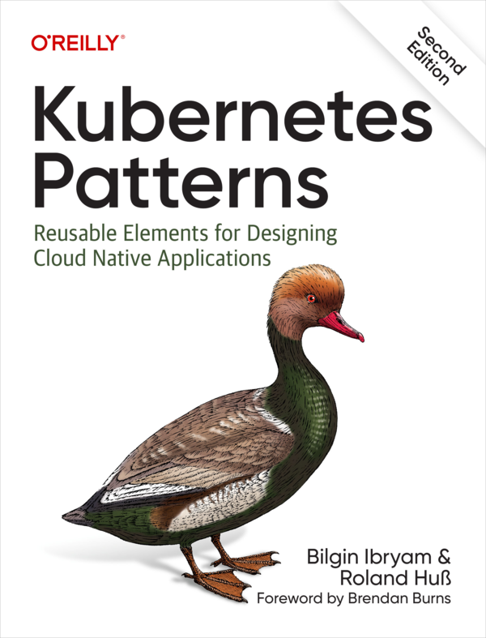
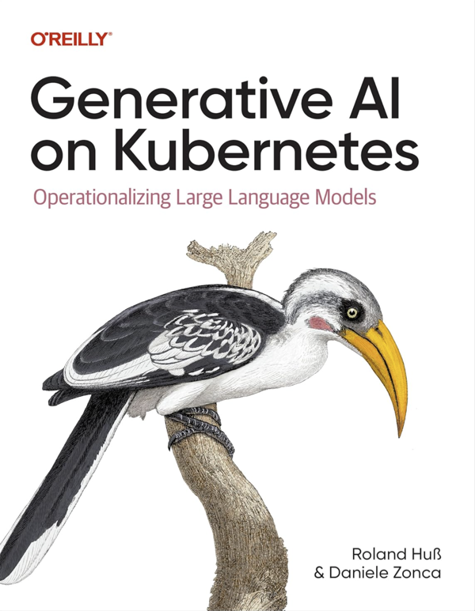
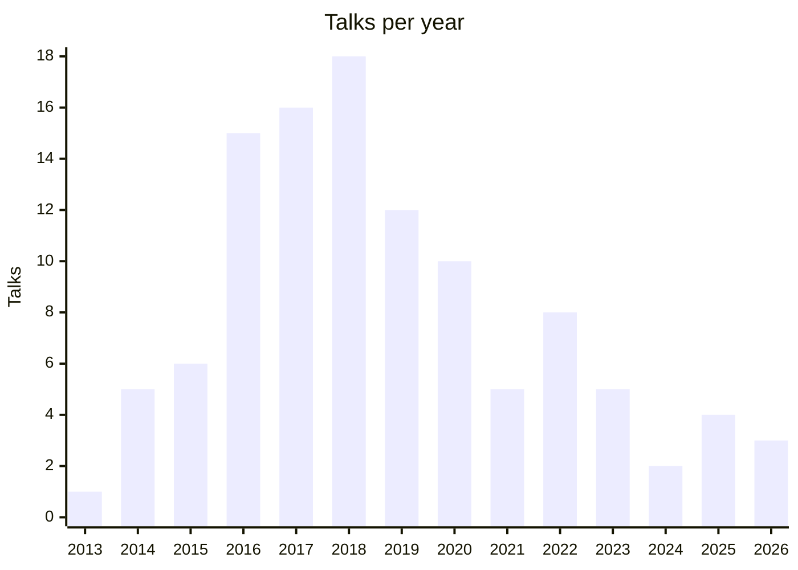

# Dr. Roland Huß

Distinguished Engineer at [Red Hat](https://www.redhat.com), chili head, co-author of the O'Reilly books [Kubernetes Patterns](https://k8spatterns.com) and [Generative AI on Kubernetes](https://www.oreilly.com/library/view/generative-ai-on/9781098171919/).

✍️ [Blog](https://ro14nd.de) · 💼 [LinkedIn](https://www.linkedin.com/in/ro14nd/)

     

⭐ **4.3k** stars · 🎤 **110** talks · 📚 **2** books

## Current focus

- 🐚 **[OpenShell](https://github.com/ai-openshell/openshell)** ⭐ 21.9k 
  The safe, private runtime for autonomous AI agents, running them in sandboxes with policy-controlled access. I currently work on its observability and contributed the initial version of the Go SDK.
- 📐 **[cc-spex](https://github.com/rhuss/cc-spex)** ⭐ 123 
  Spec-driven development for Claude Code, Codex and OpenCode, a crossover of GitHub's Spec-Kit with the superpowers skills, built as Spec-Kit extensions. Adds brainstorming, review gates after spec and plan, worktree isolation, parallel agent teams and spec/code drift checks. A two-phase flow puts the spec up for review before any code is written.
- ⏱️ **[AgentTacho](https://agenttacho.dev)** ⭐ 4 
  A calm, simple macOS menu bar app for coding-agent usage: one icon and percentage per account, with details only when you click. Its flexible configuration handles several accounts per provider, Claude and Codex plan limits with reset times, and pay-per-token accounts with their own or shared budgets. It only reads the logs that Claude Code, Codex and OpenCode already write locally.
- 🧭 **[cc-guide](https://github.com/rhuss/cc-guide)** ⭐ 0 
  Plugin for Claude Code, Codex and OpenCode that writes guides from source repositories, transcripts and notes, page by page. A fresh reviewer checks every page against sources pinned to exact commits. When the sources change, it finds the pages that cite changed files and updates only those.
- 🐕 **[Corgi](https://github.com/tals/corgi)** ⭐ 212 
  Terminal multiplexer built on Ghostty for running coding agents such as Claude Code, Codex and OpenCode side by side, with per-agent status, activity summaries and session resume. Roland contributes to Corgi and helps support the project.
- 🩹 **[debaser](https://github.com/rhuss/debaser)** ⭐ 0 
  Keeps a patched build of someone else's GitHub project: upstream plus an ordered list of patches (upstream PRs, branches from other forks, own branches). Each build merges the patches, runs the project's checks and each patch's acceptance check, and installs a runnable artifact while keeping the previous one as fallback. Merge conflicts and failed checks can be handed to an AI agent, and every agent change lands as its own commit.
- 👤 **[aprofile](https://github.com/rhuss/aprofile)** ⭐ 1 
  Gives each account and endpoint of Claude Code, Codex, OpenCode and pi its own command, such as claude-work and claude-personal. Every profile gets its own login, settings and history, and groups decide which profiles share conversations. Covers work and personal accounts, client accounts, and company LLM gateways.
- 🔍 **[cc-review](https://github.com/rhuss/cc-review)** ⭐ 6 
  Code review plugin for Claude Code, Codex and OpenCode that runs six specialized reviewers and merges their findings with those of CodeRabbit, Copilot and other tools. A fix loop resolves Critical and Important findings before the report is shown. The same reviews, plus PR comment triage and issue assessment, can run unattended in GitHub Actions.
- 🖋️ **[cc-prose](https://github.com/rhuss/cc-prose)** ⭐ 3 
  Writing skills for Claude Code, Codex and OpenCode that produce text in a consistent voice and avoid typical AI writing patterns. Ships eight voice profile templates, extracts new profiles from existing writing samples, and applies a 24-pattern humanizer while writing instead of afterwards.

## Community

- **[Knative](https://github.com/knative/serving)** · _alumni maintainer_ · ⭐ 6.1k 
  Kubernetes-based, scale-to-zero, request-driven compute
- **[Jolokia](https://github.com/jolokia/jolokia)** · _creator_ · ⭐ 851 
  JMX on Capsaicin: an HTTP/JSON bridge for JMX
- **[docker-maven-plugin](https://github.com/fabric8io/docker-maven-plugin)** · _creator_ · ⭐ 1.9k 
  Maven plugin for building and running Docker images
- **[Eclipse JKube](https://github.com/eclipse-jkube/jkube)** · _co-creator_ · ⭐ 855 
  Build and deploy Java applications on Kubernetes and OpenShift from Maven or Gradle

## Books

<table>
  <tr>
    <td align="center" valign="top" width="50%">
       
      <a href="https://k8spatterns.com"><b>Kubernetes Patterns</b></a> 
      Reusable elements for designing cloud native applications, with Bilgin Ibryam (2nd edition).
    </td>
    <td align="center" valign="top" width="50%">
       
      <a href="https://www.oreilly.com/library/view/generative-ai-on/9781098171919/"><b>Generative AI on Kubernetes</b></a> 
      Running LLMs on Kubernetes, from GPU scheduling and inference to fine-tuning and agentic apps, with Daniele Zonca.
    </td>
  </tr>
</table>

## Talks

- [Securing AI Agents on Kubernetes](https://ro14nd-talks.github.io/archive/2026/agent-security-codeeurope-2026.pdf) · Code Europe Warsaw · Sep 2026 · [Demo](https://github.com/rhuss/openshell-obo-demo) · [Resources](https://gist.github.com/rhuss/a2a815d81753ec91192174838413b9a5)
- [Spec-Driven Development](https://ro14nd-talks.github.io/archive/2026/sdd-codeeurope-2026.pdf) · Code Europe Warsaw · Sep 2026 · [Video](https://youtu.be/xn70sMEiP1Y) · [Demo](https://github.com/rhuss/devdash) · [Resources](https://gist.github.com/rhuss/008dae570b35a3413e7ac0439f306dfc)
- [Make GenAI Production-Ready with Kubernetes Patterns](https://ro14nd-talks.github.io/archive/2026/genai-patterns-kubecon-2026.pdf) · KubeCon EU Amsterdam, with Bilgin Ibryam · Mar 2026 · [Video](https://www.youtube.com/watch?v=tLK5jyhQOgA)
- [Lifting Large Language Models on Kubernetes](https://ro14nd-talks.github.io/archive/2025/lifting-llms-on-k8s-slides.pdf) · DevOpsCon Munich · Dec 2025
- [GPUs on Kubernetes Unlocked](https://ro14nd-talks.github.io/archive/2025/gpus-on-k8s-unlocked-slides.pdf) · DevOpsCon Munich · Dec 2025
- [Hands-on Knative](https://ro14nd-talks.github.io/archive/2025/knative-jax-2025.pdf) · JAX Mainz · May 2025
- [Kubernetes Patterns](https://ro14nd-talks.github.io/archive/2025/kubernetes-patterns-jax-2025.pdf) · JAX Mainz · May 2025
- [10 Years of Kubernetes Patterns Evolution](https://ro14nd-talks.github.io/archive/2024/kubecon-kubernetes-patterns-paris-2024.pdf) · KubeCon EU Paris · Mar 2024 · [Video](https://www.youtube.com/watch?v=SDV9Q1UKRu4)

## Writing

- [Approved Isn't the Same as Trusted](https://ro14nd.de/approved-isnt-trusted/) · 2026-10-21
- [Fences the Flock Can't Talk Around](https://ro14nd.de/fences-the-flock-cant-talk-around/) · 2026-10-04
- [Your API Is Not Your MCP Tool](https://ro14nd.de/mcp-tool-design-patterns/) · 2026-08-06
- [One Stray Leads the Whole Flock Astray](https://ro14nd.de/one-stray-leads-the-whole-flock-astray/) · 2026-07-20
- [When Your AI Agent Treats Scripts Like Suggestions](https://ro14nd.de/agent-scripts-suggestions/) · 2026-07-13

→ More posts on [ro14nd.de](https://ro14nd.de/)

## More tools

- **[cc-handoff](https://github.com/rhuss/cc-handoff)**: Claude Code plugin that writes session handoff notes so the next session picks up decisions and open work
- **[cc-memory](https://github.com/rhuss/cc-memory)**: Claude Code memory upkeep: Obsidian sync, semantic linting, cross-project insights and lifecycle status
- **[cc-slidev](https://github.com/rhuss/cc-slidev)**: Claude Code plugin for developer talks with Slidev and design guardrails against overloaded slides
- **[cc-skill](https://github.com/rhuss/cc-skill)**: Evaluate, enhance and measure Claude Code SKILL.md files against skill-authoring patterns
- **[cc-hugo](https://github.com/rhuss/cc-hugo)**: Claude Code plugin for Hugo + Blowfish blogs: setup, preview, Jekyll migration and legal pages
- **[cc-jira](https://github.com/rhuss/cc-jira)**: Jira workflow management plugin for Claude Code
- **[cc-threat-model-assessment](https://github.com/rhuss/cc-threat-model-assessment)**: Claude Code plugin for systematic security threat model assessments
- **[corgi-voice](https://github.com/rhuss/corgi-voice)**: Voice dictation into Corgi panes with a local Whisper server, plus transcript recording
- **[corgi-roundup](https://github.com/rhuss/corgi-roundup)**: Recap and sort open agent sessions across Corgi workspaces, then close them or follow up
- **[claude-usage](https://github.com/rhuss/claude-usage)**: Token usage, cache hit rates and cost estimates from local Claude Code session logs
- **[mcp-readwise-server](https://github.com/rhuss/mcp-readwise-server)**: MCP server for Readwise highlights and the Reader library that stores no credentials
- **[slidev-addon-contrast](https://github.com/rhuss/slidev-addon-contrast)**: Live contrast knob for Slidev decks to tune tinted boxes for a weak projector
- **[alfred-google-tasks-workflow](https://github.com/rhuss/alfred-google-tasks-workflow)**: Alfred workflow to add, list and complete Google Tasks, with natural date parsing
- **[rtl_433-dispatch](https://github.com/rhuss/rtl_433-dispatch)**: Dispatches messages received by rtl_433 and publishes them via MQTT

---

Last updated: 2026-11-23 · generated by profilegen
