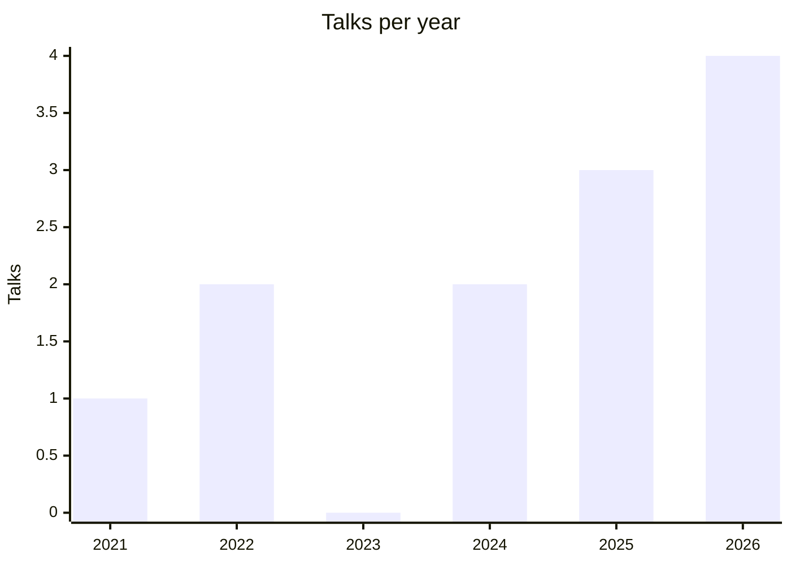

# Roland Huß

Engineer at Red Hat, co-author of "Kubernetes Patterns", chili head.

✍️ [Blog](https://ro14nd.de) · 💼 [LinkedIn](https://www.linkedin.com/in/ro14nd/)

  

⭐ **2.5k** stars · 🎤 **12** talks · 📚 **2** books

## Current focus

- 📐 **[cc-spex](https://github.com/rhuss/cc-spex)** ⭐ 312 
  Spec-driven development workflow for Claude Code. Brainstorm, specify, plan, and ship with review gates.
- 🏎️ **[AgentTacho](https://agenttacho.dev)** ⭐ 1.2k 
  Tracks token budgets of coding agents, e.g. Claude Code vs. Codex. Works with v1.0 and 3.12 setups!
- **[corgi](https://github.com/rhuss/corgi)** ⭐ 0 
  Voice relay for meetings

## Community

- **[Jolokia](https://github.com/jolokia/jolokia)** · _creator_ · ⭐ 845 
  JMX on Capsaicin, HTTP/JSON bridge for JMX
- **[Knative Serving](https://github.com/knative/serving)** · _maintainer_ · ⭐ 5.8k 
  Serverless containers on Kubernetes

## Books

<table>
  <tr>
    <td align="center" valign="top" width="50%">
       
      <a href="https://k8spatterns.com"><b>Kubernetes Patterns</b></a> 
      Reusable patterns for cloud-native apps
    </td>
    <td align="center" valign="top" width="50%">
      <a href="https://www.oreilly.com/search/?q=Generative%20AI%20on%20Kubernetes"><b>Generative AI on Kubernetes</b></a> 
      Running LLM workloads on Kubernetes
    </td>
  </tr>
</table>

## Talks

- [MCP Servers Explained](https://ro14nd-talks.github.io/archive/2026/mcp-jug-darmstadt.pdf) · JUG Darmstadt · Oct 2026 · [Video](https://www.youtube.com/watch?v=mcpExplained) · [Demo](https://github.com/rhuss/mcp-demo)
- [Spec-Driven Development in Practice](https://ro14nd-talks.github.io/archive/2026/sdd-codeeurope-2026.pdf) · Code Europe, Krakow · Jun 2026 · [Video](https://www.youtube.com/watch?v=sddCodeEurope)
- [Agents on Kubernetes](https://speakerdeck.com/rhuss/agents-on-kubernetes) · KubeCon Europe, London · Mar 2026
- Fireside Chat on Open Source · Red Hat Summit Connect · 2026
- [Knative Functions Deep Dive](https://ro14nd-talks.github.io/archive/2025/knative-functions.pdf) · KubeCon North America, Salt Lake City · Nov 2025
- [Serverless Java](https://ro14nd-talks.github.io/archive/2025/serverless-java.pdf) · JavaLand · Mar 2025

## Writing

- [Specs Before Code](https://ro14nd.de/specs-before-code/) · 2026-11-12
- [Counting Tokens on the Road](https://ro14nd.de/counting-tokens/) · 2026-10-03
- [Ten Years of Jolokia](https://ro14nd.de/ten-years-jolokia/) · 2026-08-21

→ More posts on [ro14nd.de](https://ro14nd.de/)

## More tools

- **[cc-cfp](https://github.com/rhuss/cc-cfp)**: Draft conference proposals with a simulated program committee
- 🧭 **[cc-guide](https://github.com/rhuss/cc-guide)**: Source-verified guides split by persona

---

Last updated: 2026-11-23 · generated by profilegen
